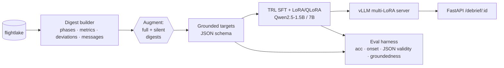

# flight-llm-debrief 🧠📝

**Fine-tune a small open LLM to read a flight log and write a grounded, structured debrief.** The output covers fault type, subsystem, onset time, flight phase, severity, evidence, a summary and recommended actions. Every number in the output must exist in the log digest.

A 15-minute sortie is roughly 9 k rows × 37 channels plus free-text autopilot messages. That is too much to paste into a prompt, and raw numbers are a poor input for an LLM anyway. This repo:

1. **compresses** each flight into a ~1.5 k-token *digest*: phase timeline, flight-test metrics, fault-agnostic deviations from the fleet-normal envelope for the same phase, and messages;
2. **builds SFT data** whose targets are **grounded by construction**: every number in the target is copied from the digest, and labels come from the flight-test card;
3. **fine-tunes** Qwen2.5 with LoRA or QLoRA (TRL `SFTTrainer`, completion-only loss);
4. **evaluates** classification, onset accuracy, schema validity and **numeric groundedness** against strong non-LLM baselines;
5. **serves** the adapter with vLLM (multi-LoRA, OpenAI-compatible) behind a FastAPI endpoint.



## Why "silent" digests matter

Each flight produces two training examples. One uses the full digest. The other is **silent**: every WARNING, ERROR and CRITICAL message is removed. Many real faults never raise a message, and a model that learns `"ESC 3 timeout" → motor_failure` is a regex with extra steps. Silent examples force diagnosis from telemetry deviations. The baselines below show exactly why this is needed.

## Results so far (300-flight reference fleet, test split = 42 flights × {full, silent})

| Generator | Fault acc. (full) | Fault acc. (**silent**) | Macro-F1 (silent) | Onset MAE | Onset within 30 s | Grounded numbers | Writes a summary? |
|---|---|---|---|---|---|---|---|
| Oracle target (evaluator sanity check) | 1.000 | 1.000 | 1.000 | 0 s | 1.00 | 99.8 % | ✓ |
| Majority class (`none`) | 0.214 | 0.214 | 0.039 | – | – | – | ✗ |
| Message keyword rules | 0.833 | **0.214** | 0.039 | 41.8 s | 0.85 | 100 % | ✗ |
| Gradient boosting on deviation features | 0.857 | 0.857 | 0.862 | 27.4 s | 0.86 | – | ✗ |
| Qwen2.5-1.5B zero-shot | *run notebook* | | | | | | ✓ |
| **Qwen2.5-1.5B + LoRA (this repo)** | *run notebook* | | | | | | ✓ |
| Claude, few-shot (frontier reference) | *`flightdebrief eval-model --backend anthropic`* | | | | | | ✓ |

The message rules collapse to the majority-class score once warnings are removed. The GBM baseline is robust, but it only classifies: it cannot explain or recommend actions. The fine-tuned model is judged on all three axes at once (accuracy on silent digests, groundedness, and summary quality), and its target is to match or beat the GBM while staying above 95 % grounded. The LLM rows need a GPU. [`notebooks/colab_finetune.ipynb`](notebooks/colab_finetune.ipynb) fills them in on a free T4 in about 40 minutes. Generate 1,000+ flights for the real run, because 300 flights (436 training examples) is the smoke-scale fleet.

### What one example looks like (real output from the pipeline)

```text
FLIGHT FLT-00002 | airframe LAT-STOL-H1 | fw lat-fc 2.3.1 | site BLR-test | wind 9.2 m/s from 227 deg
PHASES: taxi[0-18s] > takeoff_roll[18-33s] > climb[33-181s] > cruise[181-442s] > descent[442-621s] > landing_rollout[622-629s]
METRICS: duration_s=629.2, takeoff_ground_roll_m=308.292, ..., min_batt_v=354.47, max_batt_temp_c=44.6, ...
DEVIATIONS (vs fleet-normal for same phase; z=robust z-score):
- batt_v t=125.5-621.4s (climb): 359.3 vs normal 402.09 (z=-27.0)
- roll_deg t=345.2-364.1s (cruise): -25.6 vs normal 0.01 (z=-5.5)        <- a waypoint turn: must be ignored
- batt_temp_c t=441.6-475.2s (descent): 34.2 vs normal 29.9 (z=4.8)
...
```
```json
{"fault_type": "battery_degradation", "subsystem": "power", "onset_t_s": 125.0, "phase_at_onset": "climb",
 "severity": "major",
 "evidence": ["batt_v 359.3 vs normal 402.09 at t=125.5s", "batt_temp_c 34.2 vs normal 29.9 at t=441.6s"],
 "summary": "Battery pack shows degraded behaviour from t=125s (climb): ... Consistent with increased internal resistance / capacity fade.",
 "recommended_actions": ["Run cell-balance / impedance check on the pack", "..."]}
```

## Groundedness metric

`evaluate.groundedness()` extracts every number from the model's evidence and summary:
- **times** (`t=…s`) count as grounded if they fall within 30 s of a time that appears in the digest, since onset is an estimate;
- **all other numbers** must match a digest number within 1 % (or 0.05 absolute).

The report includes `grounded_rate` (the fraction of grounded numbers) and `hallucination_rate` (the fraction of answers with at least one invented number). These are cheap, deterministic and hard to game. An optional LLM-as-judge rubric for summary quality can be layered on top.

## Quickstart

```bash
pip install -e ".[train,anthropic,dev]"
make test                       # unit tests + an offline TRL/PEFT LoRA smoke fine-tune (tiny random model, no downloads)
make data dataset baselines     # 1000 simulated sorties -> digests -> SFT jsonl -> baseline table
make train eval                 # LoRA fine-tune Qwen2.5-1.5B (GPU) and evaluate on the test split
flightdebrief debrief FLT-00042 --backend hf --model Qwen/Qwen2.5-1.5B-Instruct --adapter outputs/qwen2.5-1.5b-debrief/final_adapter
```

QLoRA for a 7B model on a single 16–24 GB GPU: `python -m flightdebrief.train_sft --config configs/qwen2.5-7b-qlora.yaml`.

## Deployment

```bash
docker compose up --build      # vLLM serves base + LoRA adapter "debrief"; API on :8080
curl localhost:8080/debrief/FLT-00042
```
- **vLLM multi-LoRA:** one base model can serve several adapters (debrief, per-airframe variants) behind one OpenAI-compatible endpoint.
- **GCP:** run vLLM on a GKE L4 node pool or a Vertex AI custom container, and the API on Cloud Run. Adapters live in GCS. Alternatively, push the adapter to the Hugging Face Hub (see the notebook).
- **Edge / ground station:** merge the adapter (`merge_and_save: true`), convert to GGUF with llama.cpp, and run on a laptop at the airfield with no network.

## Repository layout
```
src/flightdebrief/
  digest.py      # log -> compact digest (fleet envelope, fault-agnostic deviations)
  targets.py     # grounded JSON targets from the flight-test card
  dataset.py     # TRL prompt/completion jsonl, full + silent augmentation, flight-level split
  schema.py      # pydantic output contract + lenient JSON parsing
  train_sft.py   # TRL SFTTrainer + PEFT LoRA/QLoRA (version-robust config), --smoke mode
  infer.py       # HF / OpenAI-compatible (vLLM, Ollama) / Anthropic generators
  evaluate.py    # accuracy, onset, JSON validity, groundedness, hallucination rate
  baselines.py   # majority, message rules, GBM on deviation features, oracle
  serve.py       # FastAPI
configs/         # 1.5B LoRA (T4), 7B QLoRA, offline smoke
notebooks/colab_finetune.ipynb
```

MIT licensed.
